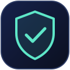
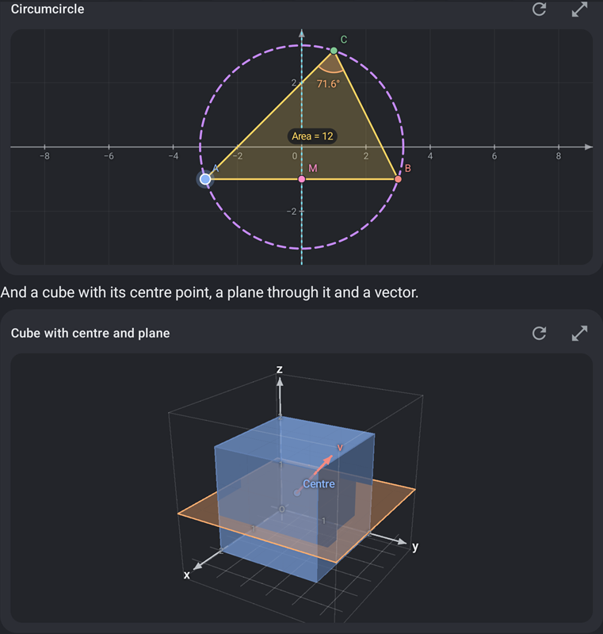
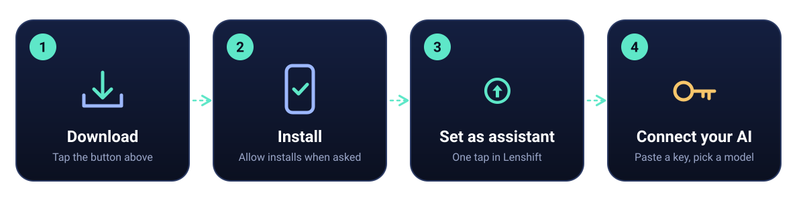

<p align="center">
  
</p>

<p align="center">
  <a href="https://github.com/jutochoppa/lenshift/releases/latest/download/Lenshift.apk"></a>
  <br>
  <sub>Free · Android 11 or newer · <a href="https://github.com/jutochoppa/lenshift/releases/latest">All releases and what's new</a></sub>
</p>

**Lenshift** puts an AI search on top of everything on your phone or tablet. Open it over any
app, circle what you're curious about, and ask. Answers come from the AI service *you* pick:
OpenAI, Google Gemini, Anthropic Claude, OpenRouter, or a model running on your own computer.
No account to create and no Google sign-in.

## What it can do

<table>
  <tr>
    <td width="50%" valign="top">
      
      <b>Circle anything</b><br>
      Circle, tap or drag over text, pictures or anything else on the screen. Text is read
      right on your device.
    </td>
    <td width="50%" valign="top">
      
      <b>Your AI, your choice</b><br>
      Works with OpenAI, Gemini, Claude, OpenRouter, Ollama and most OpenAI-compatible
      services. Switch models whenever you like.
    </td>
  </tr>
  <tr>
    <td width="50%" valign="top">
      
      <b>Graphs, geometry and 3D</b><br>
      Math answers can include exact graphs and 3D shapes that you can drag, zoom and rotate.
    </td>
    <td width="50%" valign="top">
      
      <b>Pictures on request</b><br>
      Optionally pick an image model, and answers can include generated pictures.
    </td>
  </tr>
  <tr>
    <td width="50%" valign="top">
      
      <b>Real conversations</b><br>
      Ask follow-ups, add more screenshots, and pick up your last chat with one tap.
    </td>
    <td width="50%" valign="top">
      
      <b>Private by design</b><br>
      No account, no ads, no tracking. Only what you ask about is sent, and only to your AI.
    </td>
  </tr>
</table>

<p align="center">
  
  <br>
  <sub>Real answer cards from the app: drag the points, pinch to zoom, spin the cube.</sub>
</p>

## Install in four steps

<p align="center">
  
</p>

**1. Download.** On your Android phone or tablet, tap the **Download APK** button above.

**2. Install.** Open the downloaded `Lenshift.apk` (from your notifications or the Files app).
If Android says it can't install apps from this source, tap **Settings**, turn on
**Allow from this source**, go back, and tap **Install**.

> Lenshift isn't on the Play Store, so Google Play Protect may show a warning. If it does,
> tap **More details** and then **Install anyway**.

**3. Set Lenshift as your assistant.** Open Lenshift and tap the ⚙️ gear at the top. Tap
**Assistant role**, then **Open settings**. Tap **Digital assistant app** (on some phones it's
called **Default digital assistant app**), pick **Lenshift**, and confirm. Back in Lenshift,
the badge turns **Active**.

**4. Connect your AI.** In Lenshift's settings, under **AI provider**, tap **Setup**, then
**Add a provider**. Choose a protocol from the table below, paste the **Base URL** and your
**API key**, tap **Add a model** and pick one from the list, then tap **Save provider**.
That's it!

<details>
<summary><b>Which AI service should I pick, and where do I get a key?</b></summary>
<br>

| Service | Protocol to choose | Base URL to paste | Get a key |
|---|---|---|---|
| **OpenRouter** (hundreds of models from one key, some of them free) | OpenAI-compatible Chat Completions | `https://openrouter.ai/api/v1` | [openrouter.ai/keys](https://openrouter.ai/keys) |
| **OpenAI** | OpenAI Responses API | `https://api.openai.com/v1` | [platform.openai.com/api-keys](https://platform.openai.com/api-keys) |
| **Google Gemini** | Google Gemini | `https://generativelanguage.googleapis.com/v1beta` | [aistudio.google.com/apikey](https://aistudio.google.com/apikey) |
| **Anthropic Claude** | Anthropic Messages | `https://api.anthropic.com/v1` | [console.anthropic.com](https://console.anthropic.com/) |
| **Ollama** on your own computer | Ollama (local) | `http://YOUR-COMPUTER-IP:11434` | No key needed. Turn on **Allow plain HTTP** in the same form. |

Not sure? Start with **OpenRouter**: one key gives you models from many companies.

Lenshift itself is free. AI services charge for what you use, usually a fraction of a cent
per question, and several offer free tiers or free models.

</details>

## How to use it

1. **Open Lenshift over any app.** Use your phone's assistant gesture (long-press the home
   button, or swipe up from a bottom corner, depending on your phone), the **Lenshift tile**
   in Quick Settings, or **Share → Lenshift** on any picture or text.
2. **Select something.** Circle it, tap it, or long-press text.
3. **Ask.** Type in **Ask about this selection**, or tap a quick action like **Explain** or
   **Translate**. The answer appears right away, and you can keep asking follow-ups.

To get back to an earlier answer, tap **Continue** on the selection screen to resume your last
chat, or open **History** to find older ones.

**Optional extras in settings:** an image model for pictures, web results tabs, saving chat
history, and per-model options like reasoning effort.

## Questions and fixes

<details>
<summary><b>The assistant gesture opens Google instead of Lenshift</b></summary>
<br>

Check **Settings → Apps → Default apps → Digital assistant app** and choose Lenshift. On
some Pixel and Samsung phones, holding the navigation bar is reserved for Circle to Search.
Turn that off in your phone's settings, or open Lenshift from its Quick Settings tile.
</details>

<details>
<summary><b>Android asks to allow screen capture every time</b></summary>
<br>

That only happens when you open Lenshift from the tile or a shortcut. Either open it with the
assistant gesture, which never asks, or turn on **Accessibility screenshot fallback** in
Lenshift once. That permission lets Lenshift take a screenshot and nothing else.
</details>

<details>
<summary><b>"App not installed" when updating</b></summary>
<br>

You probably have a copy from somewhere else that was signed differently. Uninstall the old
Lenshift first, then install the new one. Updates downloaded from this page install over each
other normally.
</details>

<details>
<summary><b>I get an error instead of an answer</b></summary>
<br>

Check that the Base URL is only the address from the table above, with nothing after it,
and that your key is correct. Make sure your account with that service has credit, or that
you picked a free model. The **Diagnostics** screen in Lenshift shows what your phone
supports.
</details>

<details>
<summary><b>What leaves my phone?</b></summary>
<br>

- Only the part you selected and your question, sent to the AI service you set up, when you ask.
- Text in screenshots is read on your device. Screenshots aren't uploaded anywhere else.
- Your API keys are encrypted on the device with Android Keystore.
- Chats are saved only on your device, only if **Save chat history** is on, and you can
  delete them at any time.
- No account, no analytics, no ads. Optional web results tabs contact the search engine
  only when you open them.
</details>

## For developers

Requirements: JDK 17 or newer and the Android SDK (platform 36).

```bash
./gradlew :app:assembleDebug          # build a debug APK
./gradlew :app:testDebugUnitTest      # run the unit tests
```

Release builds are signed from environment variables, so no keystore or password is ever
committed. `tools/build_release.sh /path/to/key-info.txt` builds `build/release/Lenshift.apk`.
`tools/mock_provider.py` is a local fake AI server for the instrumented tests. See
[docs/architecture.md](docs/architecture.md) for how the app is put together.

## License

Lenshift is **free for personal and other noncommercial use** under the
[PolyForm Noncommercial License 1.0.0](LICENSE). You may use, study, change and share it for
noncommercial purposes. **Selling it or using it commercially is not allowed.**

Bundled open-source components keep their own licenses: Tesseract4Android and its English
language data (Apache-2.0), AndroidMath (MIT), OkHttp, AndroidX and Jetpack Compose
(Apache-2.0), and JSON-java (public domain).

Lenshift is an independent project. It is not affiliated with, endorsed by or connected to
Google. Android and Circle to Search are trademarks of Google LLC.
